<p align="center">
  <a href="https://undominated.ai/">
    <picture>
      <source media="(prefers-color-scheme: dark)" srcset="docs/brand/lockup-dark.png">
      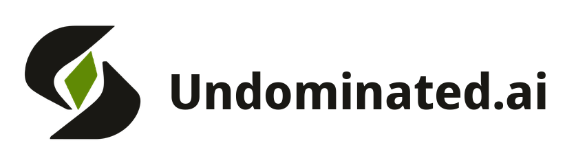
    </picture>
  </a>
</p>

<p align="center">
  <strong>Best first. Then price.</strong><br>
  <em>Independent dominance tables for AI inference, with the evidence beside every figure.</em>
</p>

<p align="center">
  <a href="https://undominated.ai/"></a>
  <a href="https://undominated.ai/frontier/"></a>
  <a href="https://undominated.ai/"></a>
  <a href="https://undominated.ai/check/"></a>
  <a href="https://www.npmjs.com/package/undominated-check"></a>
  <a href="https://huggingface.co/datasets/LPH98/undominated-ai-model-pricing"></a>
  <a href="https://github.com/Lenvanderhof/Undominated.ai/releases"></a>
  <a href="https://github.com/Lenvanderhof/Undominated.ai/discussions"></a>
  <a href="https://github.com/Lenvanderhof/Undominated.ai/issues/new?template=wrong-price.yml"></a>
</p>

<p align="center">
  <a href="https://undominated.ai/">Open the platform</a> ·
  <a href="https://undominated.ai/check/">Check the model you already pay for</a> ·
  <a href="#bring-the-evidence-into-your-tools">Bring it into your tools</a> ·
  <a href="docs/GETTING-STARTED.md">Get started</a>
</p>

---

<p align="center">
  <a href="https://undominated.ai/frontier/">
    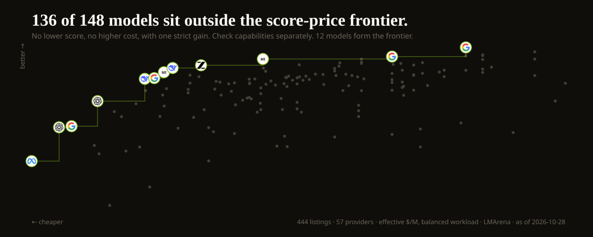
  </a>
</p>

<p align="center">
  <sub>Every dot is a published price. Generated from the live board by <code>scripts/build-hero.mjs</code>.</sub>
</p>

---

Most AI “value” tables invent a score, then sort by it.

Undominated.ai does the opposite. It ranks language models on **independently measured capability first**, then compares what they actually cost across providers. A model is named as dominated when another scores at least as high and costs no more, and is better on one of the two. A model that has not been measured is **unrated**, never zero.

> **<!--fig:dominatedOfRated-->134 of 145<!--/fig-->** rated, priced models have an alternative on the board with a higher score or a lower price, with neither dimension worse. They cost a median **<!--fig:overpayMedian-->6.5×<!--/fig-->** the cheapest such alternative.<br>
> **<!--fig:frontier-->11<!--/fig-->** are not. That set is the value frontier.

Every catalogue and directory figure on this page is generated from the live site by `scripts/refresh-readme.mjs` and `scripts/build-floor-table.mjs`, last on **<!--fig:asOf-->2026-10-15<!--/fig-->** (<!--fig:models-->442<!--/fig--> catalogue listings, <!--fig:providers-->53<!--/fig--> provider labels). CI checks them, because a README that states a number by hand states a wrong one within the week. **[The live board is still the source](https://undominated.ai/).**

<p align="center">
  <a href="https://undominated.ai/">
    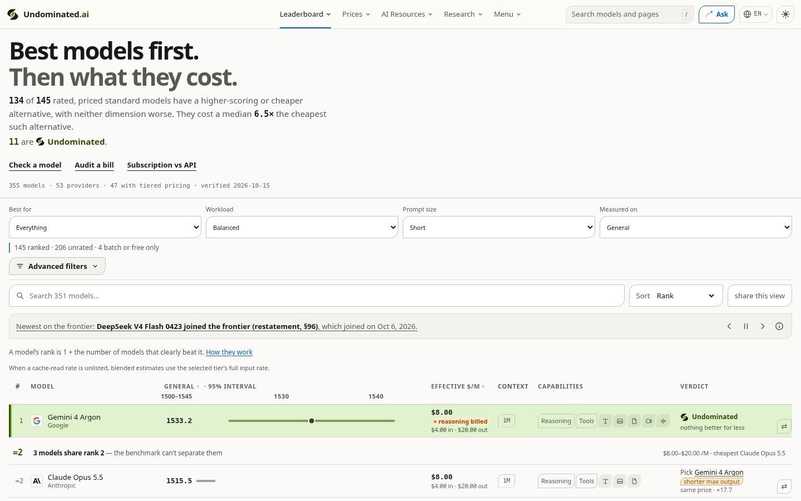
  </a>
  <br>
  <sub>Leaderboard · captured 2026-10-15 · chartreuse is frontier membership, not decoration</sub>
</p>

<table>
  <tr>
    <td width="38%" valign="top">
      <a href="https://undominated.ai/">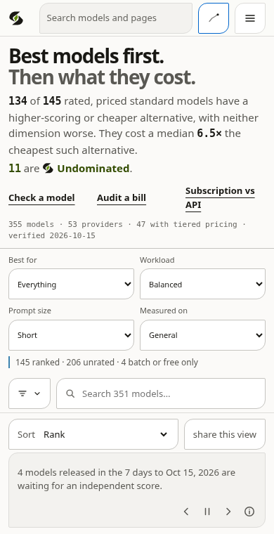</a>
      <br>
      <sub>Phone · the same board at 390 px</sub>
    </td>
    <td width="62%" valign="top">
      <a href="https://undominated.ai/frontier/">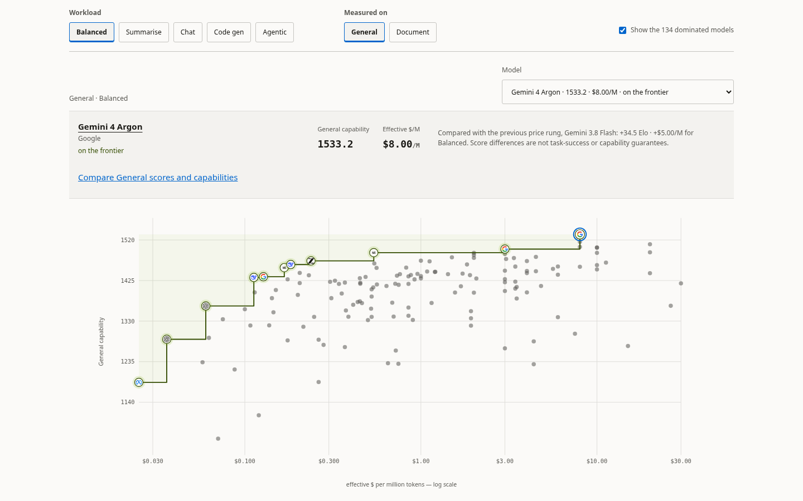</a>
      <br>
      <sub><a href="https://undominated.ai/frontier/">Frontier</a> · the staircase is the argument</sub>
    </td>
  </tr>
  <tr>
    <td valign="top">
      <a href="https://undominated.ai/check/">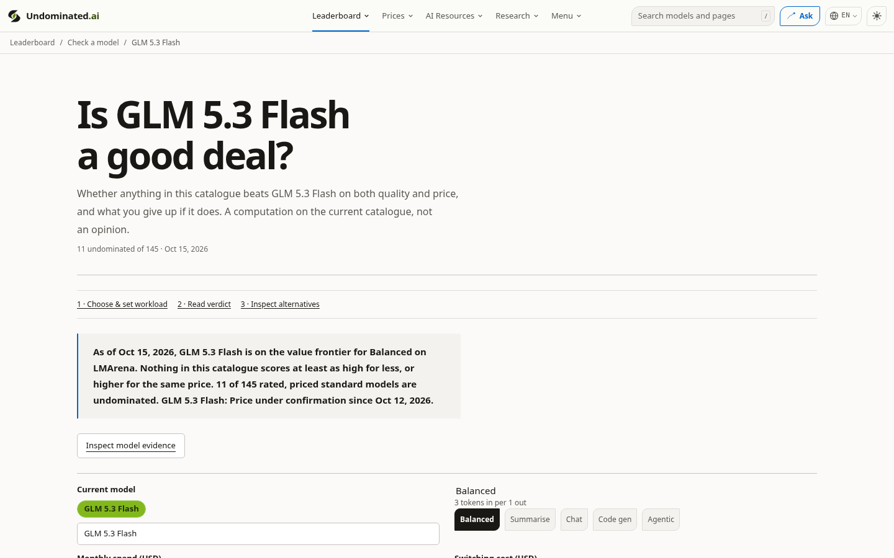</a>
      <br>
      <sub><a href="https://undominated.ai/check/">Check</a> · paste what you already pay for</sub>
    </td>
    <td valign="top">
      <a href="https://undominated.ai/tools/">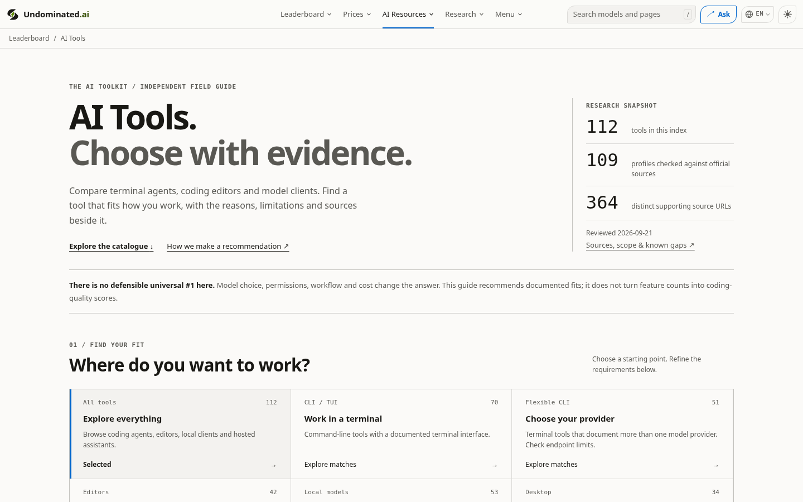</a>
      <br>
      <sub><a href="https://undominated.ai/tools/">Tools</a> · documented fit, not a quality score</sub>
    </td>
  </tr>
  <tr>
    <td valign="top" colspan="2">
      <a href="https://undominated.ai/plans/">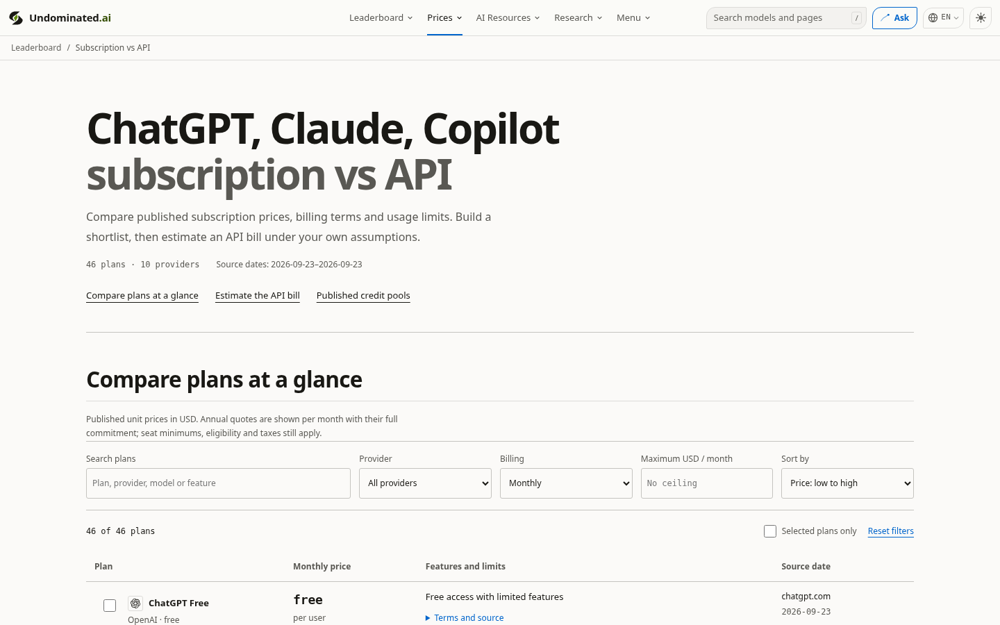</a>
      <br>
      <sub><a href="https://undominated.ai/plans/">Plans</a> · subscription against API, vendor-worded limits</sub>
    </td>
  </tr>
</table>

<p align="center">
  <a href="https://undominated.ai/now/">
    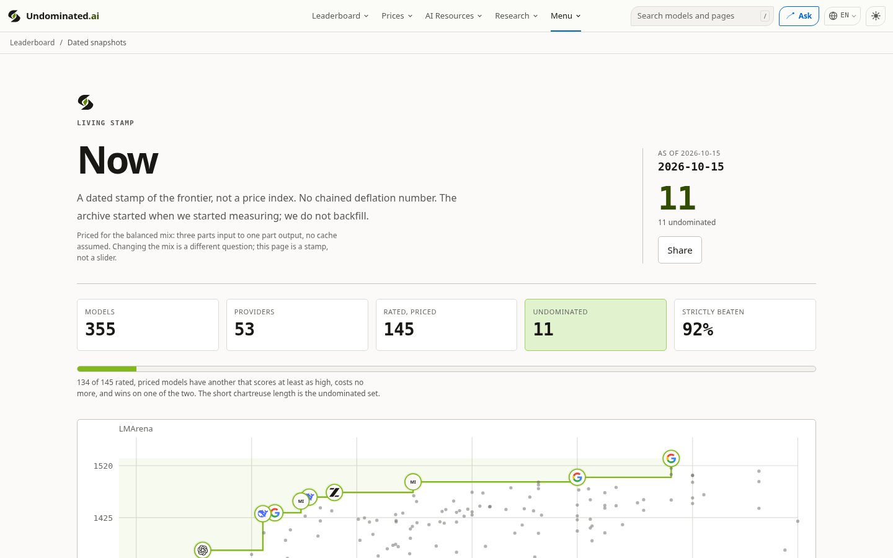
  </a>
  <br>
  <sub><a href="https://undominated.ai/now/">Now</a> · a stamp with a date and a hash, not a blended index</sub>
</p>

---

## Why a price index that refuses to average

The dearest input price in the catalogue is about **<!--fig:spread-->12,500×<!--/fig-->** the cheapest. That is not a rounding error. It is the reason a “value score” is a marketing instrument: it can hide a worse-and-dearer row behind a single attractive number.

Undominated.ai publishes the uncomfortable version:

| Claim the market likes | What this index actually does |
| --- | --- |
| A blended “value” rank | Capability first, effective price second. Never mixed into one score. |
| Unrated at the bottom | Unrated is not zero. Models with no score on the benchmark the board ranks on are listed by price and kept out of quality order. [The methodology page states the current share](https://undominated.ai/methodology/). |
| Integer ranks as fact | Significance ranks. Models the benchmark cannot separate **share a rank**: today the published confidence intervals leave **<!--fig:distinctRanks-->73<!--/fig--> distinct ranks across <!--fig:rankPositions-->145<!--/fig--> positions**. |
| “Cheaper is better” | Cheaper is cheaper. A model is dominated when another scores at least as high and costs no more, and is better on one of the two. The other is a clean replacement only when it keeps every recorded capability: context window, maximum output, input modalities, tool use and reasoning. |
| Headline $/M | **<!--fig:tiered-->70<!--/fig-->** of the <!--fig:models-->442<!--/fig--> catalogue listings change rate past a context threshold. The board reprices the row when your prompt crosses it. |
| Affiliate “best” lists | **No cut of inference. No affiliate. No paid placement. No gateway.** |

The method, the hedges and the licensing limits: [undominated.ai/methodology](https://undominated.ai/methodology/).

<p align="center">
  <a href="https://undominated.ai/methodology/">
    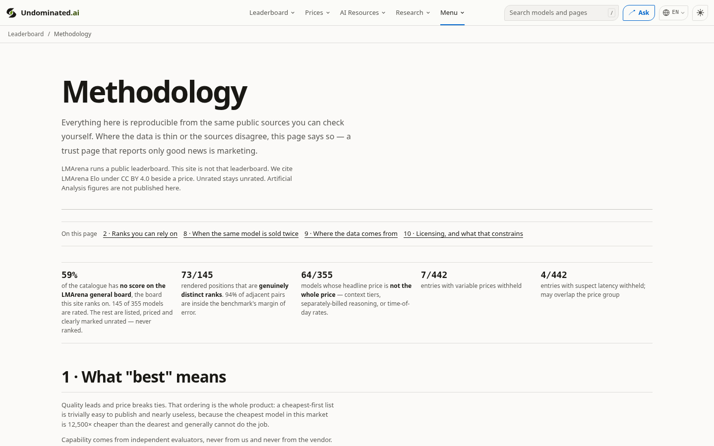
  </a>
</p>

---

## The platform

Every route answers a decision, not a document type.

**Choose a model**

| You want to | Open |
| --- | --- |
| See what is actually worth buying | [Leaderboard](https://undominated.ai/) · [Best by lens](https://undominated.ai/best/) |
| See the <!--fig:frontier-->11<!--/fig--> nothing dominates | [Frontier](https://undominated.ai/frontier/) · [Quality knee](https://undominated.ai/knee/) |
| Test the model you already use | [Check](https://undominated.ai/check/) · [Check a repo](https://undominated.ai/check-repo/) |
| Filter by requirements | [Model finder](https://undominated.ai/finder/) · [Comparisons](https://undominated.ai/compare/) · [Alternatives](https://undominated.ai/alternatives/) |
| Find the cheapest model above a quality floor | [Cheapest at](https://undominated.ai/cheapest-at/) |
| Replace a retiring model like for like | [Migration guide](https://undominated.ai/migrate/) · [Deprecations](https://undominated.ai/deprecations/) |
| Browse every publishable model | [All models](https://undominated.ai/models/) · [New releases](https://undominated.ai/new/) |
| Rank image, video or embedding models the same way | [Images](https://undominated.ai/images/) · [Video](https://undominated.ai/video/) · [Embeddings](https://undominated.ai/embeddings/) · [Vision input](https://undominated.ai/vision/) |

**Understand the price**

| You want to | Open |
| --- | --- |
| Estimate a workload or check a bill | [Cost calculator](https://undominated.ai/calculator/) · [Bill audit](https://undominated.ai/audit/) (client-side; no upload) |
| Compare subscription plans to API | [Plans](https://undominated.ai/plans/) |
| See whether shopping around is worth it | [Providers](https://undominated.ai/providers/) · [Spreads](https://undominated.ai/spreads/) · [OpenRouter or direct](https://undominated.ai/openrouter-vs-direct/) |
| See where a headline rate changes | [Context cliffs](https://undominated.ai/cliffs/) · [Reasoning price](https://undominated.ai/reasoning-price/) · [Reasoning effort](https://undominated.ai/effort/) |
| Use cheaper delivery conditions | [Batch](https://undominated.ai/batch/) · [Cached input](https://undominated.ai/cache/) · [Off-peak](https://undominated.ai/off-peak/) |
| Follow what moved | [Price changes](https://undominated.ai/price-changes/) · [The wire](https://undominated.ai/wire/) · [Now](https://undominated.ai/now/) |
| Avoid named pricing failure modes | [Traps](https://undominated.ai/traps/) |

**Run it yourself**

| You want to | Open |
| --- | --- |
| Ask whether an open-weight model fits your machine | [Self-host](https://undominated.ai/self-host/) · [Open weights](https://undominated.ai/open-weights/) · [Open against closed](https://undominated.ai/open-vs-closed/) |
| Check what a weight licence allows | [Licences](https://undominated.ai/licences/) |

**Build with AI**

| You want to | Open |
| --- | --- |
| Pick a coding agent, editor or model client | [AI tools](https://undominated.ai/tools/) |
| Find reviewed instructions, roles and integrations | [Skills](https://undominated.ai/skills/) · [Agents](https://undominated.ai/agents/) · [MCP servers](https://undominated.ai/mcp-servers/) · [Workflows](https://undominated.ai/workflows/) |

**Check the method**

| You want to | Open |
| --- | --- |
| Read how ranking is computed | [Methodology](https://undominated.ai/methodology/) · [Benchmark guide](https://undominated.ai/benchmarks/) · [Glossary](https://undominated.ai/glossary/) |
| See which adjacent ranks the benchmark cannot separate | [Significance](https://undominated.ai/significance/) · [Blind rank test](https://undominated.ai/blind-rank/) · [Disagreement](https://undominated.ai/disagreement/) |
| Hold the commercial boundaries | [Independence](https://undominated.ai/independence/) |
| See applied corrections, or file one | [Corrections](https://undominated.ai/corrections/) · [Report](https://undominated.ai/report/) |
| Read the data as JSON, or embed a verdict | [API](https://undominated.ai/api/) · [Badges](https://undominated.ai/badges/) · [Press kit](https://undominated.ai/press/) |

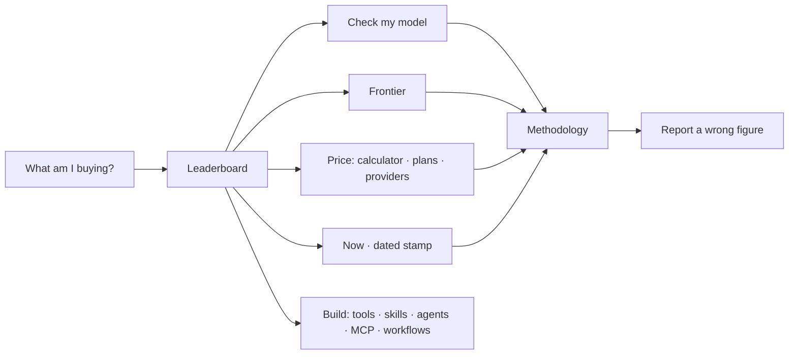

English is the source language. Other locales ship as machine translation with numbers, model names and provider names left untouched. Model pages stay English-only.

### AI resources

The [Skills](https://undominated.ai/skills/), [Agents](https://undominated.ai/agents/), [MCP servers](https://undominated.ai/mcp-servers/) and [Workflows](https://undominated.ai/workflows/) directories list **<!--fig:skills-->684<!--/fig--> skills, <!--fig:agents-->401<!--/fig--> agent definitions, <!--fig:mcpServers-->326<!--/fig--> MCP servers and <!--fig:workflows-->88<!--/fig--> workflows**, from the published indexes reviewed <!--fig:resourcesAsOf-->2026-10-14<!--/fig-->. Each third-party entry is read at a pinned source revision and records its licence, permissions and what was not tested. A source review is not a runtime test or a security certificate.

<p align="center">
  <a href="https://undominated.ai/skills/">
    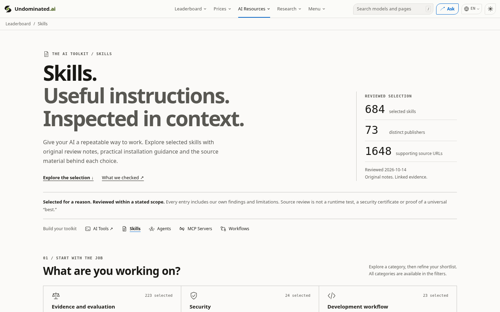
  </a>
  <br>
  <sub><a href="https://undominated.ai/skills/">Skills</a> · captured 2026-10-15</sub>
</p>

---

## Bring the evidence into your tools

This repository supplies the installable skills, portable agent profiles, CLI and read-only MCP server.

**Check a model** and quote its published verdict:

```sh
npx undominated-check@0.5.0 google/gemini-3.7-flash --json
```

**Use a skill.** Run this in your terminal. The Skills CLI lets you choose your AI tools, project or global scope, and installation method:

```sh
npx skills add Lenvanderhof/Undominated.ai --skill undominated-evidence-audit
```

Our own installer also offers guided setup:

```sh
npx undominated-check install
# Or open setup for one bundled resource:
npx undominated-check install undominated-evidence-audit
```

Choose one or more supported tools and project/global scope, review the destinations, then confirm. Cancel before confirmation to leave files untouched. Version **0.5.0** bundles eleven original skills, six agent profiles and the MCP server; it verifies file hashes and refuses existing destinations. Explicit flags remain available for scripts, and MCP registration remains a separate manual step. [Supported targets and scope](docs/INSTALLER.md). Node.js **22.12+** is required; offline skill checks use **Python 3.10+**.

**Connect an MCP client.** Use `npx` with arguments `["--yes", "undominated-mcp@0.1.0"]`. Its five read-only tools retrieve model details, verdicts, the frontier and resource reviews. It does not install resources or route inference. [MCP setup and examples →](docs/GETTING-STARTED.md#mcp-server)

**Portable agent profiles** define specialist roles; copying an `AGENT.md` does not register a native subagent. [Choose a role →](docs/RESOURCES.md#portable-agent-profiles)

**Copy a badge.** The SVG is the published verdict. Swap the key for the model you ship.

<p align="center">
  <a href="https://undominated.ai/models/google__gemini-4-argon/">
    
  </a>
</p>

```markdown
[](https://undominated.ai/models/google__gemini-4-argon/)
```

`<key>` is the same segment as `/models/<key>/`. Replace `/` and `:` in the model id with `__`. The badge states one model's dominance verdict at the balanced workload on the LMArena lens, with the date it was computed. It changes when that verdict changes. Unrated is labelled unrated, not scored zero. [All badge forms](https://undominated.ai/badges/).

**Warn on a dominated model in pull requests** (GitHub Action):

```yaml
# .github/workflows/undominated-warn.yml
name: undominated-warn
on:
  pull_request:
jobs:
  warn:
    runs-on: ubuntu-latest
    permissions:
      contents: read
      pull-requests: write
    steps:
      - uses: actions/checkout@v4
      - uses: Lenvanderhof/Undominated.ai/actions/dominated-warn@v1
        continue-on-error: true
```

Warns. Never fails the job. Do not add it to required checks.

Resource reviews record source revisions, licences, permissions and untested scope. The original skills check explicit inputs with synthetic examples; a passing check does not certify source truth or production suitability.

| Explore further | What you will find |
|---|---|
| [Getting started](docs/GETTING-STARTED.md) | Installation, examples and troubleshooting |
| [Source library](docs/RESOURCES.md) | Skill use cases, agent roles and version-specific installation coverage |
| [Installer](docs/INSTALLER.md) | Supported targets, scope and limits |
| [Evidence](docs/EVIDENCE.md) | Release verification and claim boundaries |
| [Platform guide](docs/PLATFORM.md) | Pricing tools, research downloads, data APIs and dated observations |
| [Contributing](CONTRIBUTING.md) | Resource improvements, reproducible bugs and primary-source corrections |
| [Security](SECURITY.md) · [Licence map](LICENSE) | Reporting channels and component/data boundaries |

---

## What “undominated” means here

A model is **dominated** when another model in the catalogue scores at least as high *and* costs no more under the selected workload, and is better on one of the two. A higher score at the same price counts, and so does the same score at a lower price. Scores are compared as published LMArena Elo point estimates, not significance ranks. The dominating model is a clean replacement only when it can also do everything the first one can: context window, maximum output, input modalities, tool use and reasoning. Otherwise the index names what you would give up.

A model is **on the frontier** when nothing in the catalogue dominates it under the selected lens and workload: nothing scores at least as high for less, or higher for the same price.

That is a Pareto statement, not a vibe. Chartreuse in the interface is reserved for frontier membership. It is not a brand highlight colour.

Quality on the board is **LMArena Elo**, from the official CC BY 4.0 dataset, with the published confidence interval. Unrated is not zero. Artificial Analysis figures are not published here. Switching the task lens re-ranks the same prices; it does not invent a hybrid score.

---

## This repository

**Undominated.ai lives at [undominated.ai](https://undominated.ai/).** This GitHub repository is its public face: a landing page you can star, cite and link; the public tools and resource source; a **public issue tracker** for corrections; **Discussions** for questions; and **dated catalogue dumps** you can download without scraping the live board.

It is not a place to send scraped prices, and it is not the production application or a live price-feed checkout. The live board remains the source.

| In this repo | On the live site |
| --- | --- |
| This README and the [platform guide](docs/PLATFORM.md) | The ranked board, updated from sourced pages |
| [Releases](https://github.com/Lenvanderhof/Undominated.ai/releases): dated JSON/CSV dumps and CLI releases | Prices, scores, significance ranks |
| The CLI, installer, read-only MCP server, original skills and agent profiles | Reviewed third-party skills, agents, MCP servers and workflows |
| Issue templates and Discussions | Methodology, independence, corrections log |
| Brand mark and screenshots | Dated stamps, Markdown, JSON and RSS |

Machine-readable surfaces stay on the origin, where they can carry provenance:

- [`/llms.txt`](https://undominated.ai/llms.txt): facts for agents
- [`/data/catalogue.json`](https://undominated.ai/data/catalogue.json): the public catalogue
- [`/data/frontier.json`](https://undominated.ai/data/frontier.json): the published frontier
- [`/data/resources/skills.json`](https://undominated.ai/data/resources/skills.json): reviewed resource indexes (also `agents`, `mcp-servers`, `workflows`)
- [`/badge/<key>.svg`](https://undominated.ai/badges/): README dominance badge
- [`/?format=md`](https://undominated.ai/?format=md): any page as Markdown
- [`/now/`](https://undominated.ai/now/): dated frontier stamp (hash on the page)
- [`/data/citation.json`](https://undominated.ai/data/citation.json): what is citable, with hashes

---

## Download the catalogue

The live board is rebuilt in place. A citation needs bytes that will still be there next year.

| What | Where |
| --- | --- |
| Dated dumps (JSON + CSV, no Artificial Analysis fields) | [GitHub Releases named `catalogue-YYYY-MM-DD`](https://github.com/Lenvanderhof/Undominated.ai/releases) |
| The same dumps on Hugging Face | [`LPH98/undominated-ai-model-pricing`](https://huggingface.co/datasets/LPH98/undominated-ai-model-pricing) |
| How to cite | [`CITATION.cff`](CITATION.cff) · [`datasets/README.md`](datasets/README.md) |
| What is *not* citable | [`catalogue.json` and per-model JSON](https://undominated.ai/data/citation.json): rebuilt on every deploy, no date in the path |

LMArena Elo in the dump is **CC BY 4.0** from the official Hugging Face dataset. Vendor list prices are facts the vendor published. Artificial Analysis fields are **not in the file**.

---

## Report a wrong figure

If a live price, score or rank disagrees with a primary source, file it here. The form requires the model, what the page shows, what it should be, a source URL and the date you checked.

<p align="center">
  <a href="https://github.com/Lenvanderhof/Undominated.ai/issues/new?template=wrong-price.yml"><strong>Open a correction issue →</strong></a><br>
  <sub>Same form as <a href="https://undominated.ai/report/">undominated.ai/report</a>. Corrections with a primary source are applied on the site. Public log: <a href="https://undominated.ai/corrections/">/corrections/</a>.</sub>
</p>

Security reports: [open an advisory on this repository](https://github.com/Lenvanderhof/Undominated.ai/security/advisories/new). Do not use a public issue for anything that would let someone alter rankings.

---

## Independence, in one screen

- No cut of inference.
- No affiliate links.
- No paid placement, badges or “featured” rows.
- No gateway. We do not sit on the request path.
- Revenue in v1: none. A later paid feed, if it exists, would sell history and provenance, not a better rank.

The charter: [undominated.ai/independence](https://undominated.ai/independence/).

---

## Is capability actually getting cheaper?

Everyone publishes today's prices. Nobody publishes what the **cheapest model clearing a fixed quality bar** costs, tracked across dated snapshots, and that is the only series that answers the question, because a discount on one SKU is not the same as capability getting cheaper.

<!--floors-->

| Capability floor (LMArena) | 2026-08-24 | 2026-10-15 | Move | Cheapest today |
|:---|---:|---:|---:|:---|
| **≥ 1200** | $0.0525 | $0.036 | -31% | `openai/gpt-oss-20b` |
| **≥ 1350** | $0.0525 | $0.06 | +14% | `openai/gpt-oss-120b` |
| **≥ 1400** | $0.0611 | $0.1125 | +84% | `deepseek/deepseek-v4-flash` |
| **≥ 1450** | $0.4961 | $0.1675 | -66% | `xiaomi/mimo-v2.6-flash` |

<sub>Effective $/M on the balanced workload, from 21 dated snapshots. Generated by `scripts/build-floor-table.mjs`. The floors are append-only — a threshold is never edited in place, because a moved goalpost turns a series into marketing.</sub>

<!--/floors-->

The floors are defined once and never moved. Every point comes from a dated, hashed snapshot that is [published and citable](https://undominated.ai/data/citation.json); the archive only grows, so this series cannot be back-filled by anyone starting tomorrow.

---

## The campaign stills

Three families, shot around the Dual Witness mark. They are scene treatments, **not a second logo**: use them with attribution and never redraw the mark from a photograph.

<table>
  <tr>
    <td width="33%" align="center">
      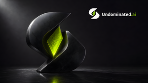<br>
      <sub><strong>Material Witness</strong><br>the primary family</sub>
    </td>
    <td width="33%" align="center">
      <br>
      <sub><strong>Proof Cinema</strong><br>supporting</sub>
    </td>
    <td width="33%" align="center">
      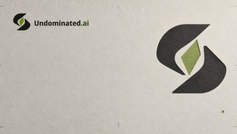<br>
      <sub><strong>Evidence Editorial</strong><br>supporting</sub>
    </td>
  </tr>
</table>

The full set at full resolution, with the mark, the lockups and the usage rules: **[undominated.ai/press/](https://undominated.ai/press/)**.

---

## Licensing, said plainly

LMArena leaderboard data on the site is used under **CC BY 4.0** from the official dataset.

Artificial Analysis figures are **not published** on the site. There is no redistribution licence, so they inform what gets checked and never what a reader sees. **This repository does not grant a sublicence** to republish those scores, and it does not copy them into Git.

Vendor prices are facts the vendor published. Every live row is supposed to carry a source link and a fetch date. If one does not, that is a [correction](https://github.com/Lenvanderhof/Undominated.ai/issues/new?template=wrong-price.yml).

Software, skills, data dumps and brand assets carry different terms: see the [licence map](LICENSE).

---

<p align="center">
  <a href="https://undominated.ai/">
    <picture>
      <source media="(prefers-color-scheme: dark)" srcset="docs/brand/raster/mark-dark-on-dark-128.png">
      
    </picture>
  </a>
  <br>
  <strong><a href="https://undominated.ai/">undominated.ai</a></strong>
  <br>
  <sub>Best first. Then price. · Built and maintained by <a href="https://lenvanderhof.com">Len van der Hof</a> · 2026</sub>
</p>
